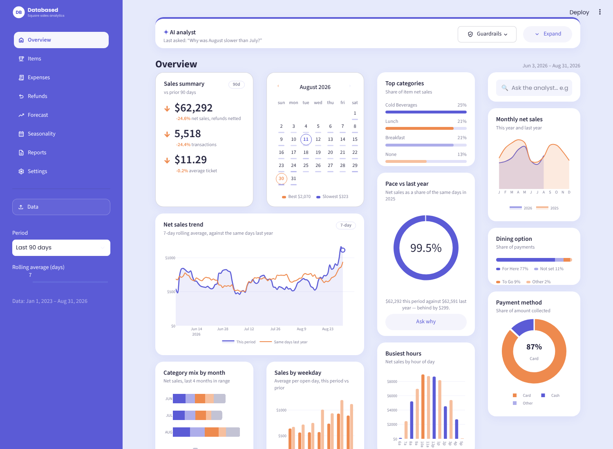
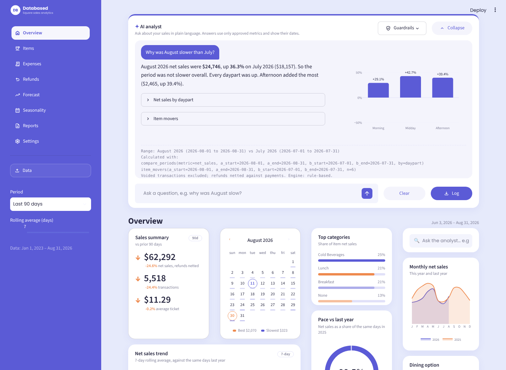
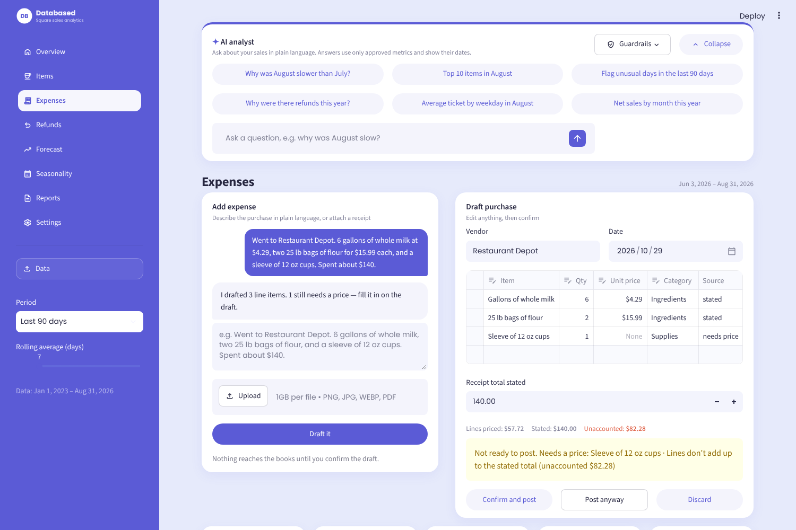
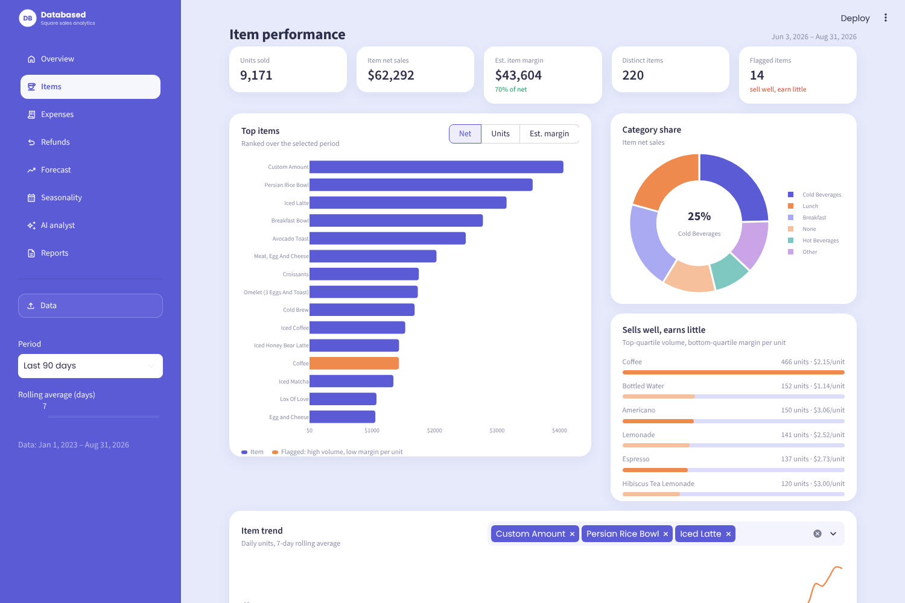
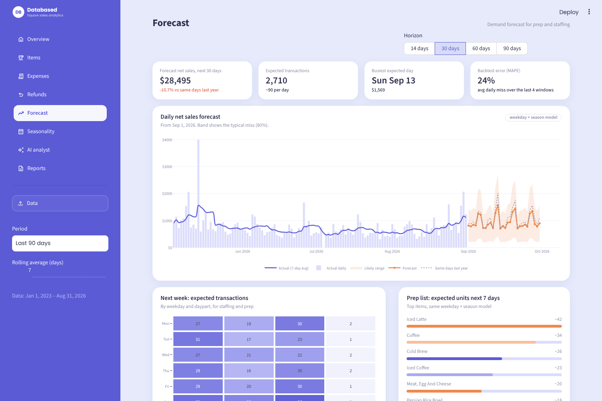
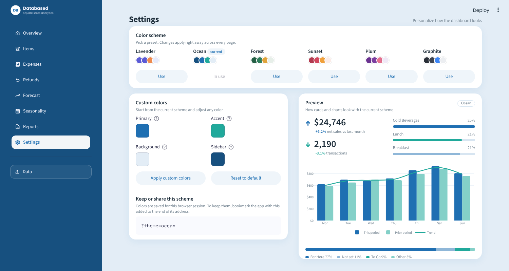
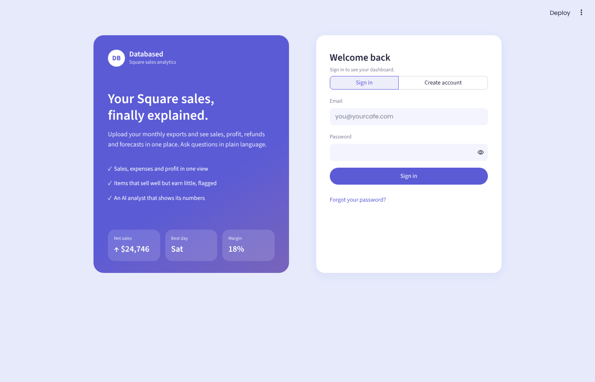
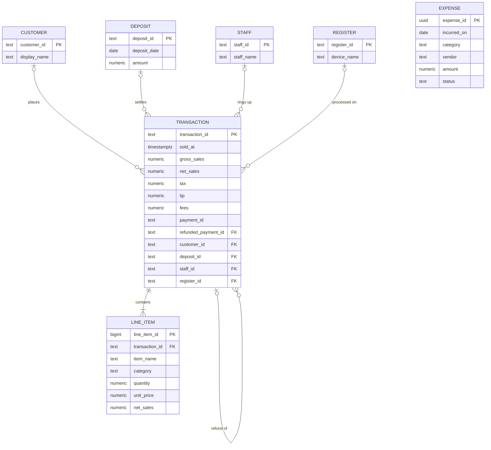

# Databased: Square Register Sales Analytics

A browser dashboard that helps small food and beverage businesses understand their sales without needing a
statistics background. Upload the monthly CSV exports from a Square register and Databased turns them into
sales trends, item performance, refunds, expenses and profit, forecasts and seasonal patterns. An AI analyst
answers questions like *"Why was August slow?"* in plain language.

Built by **Advait Ashtikar, Madeline Berns and Andy Chen**.

**[Try the live app → squareanalysis.streamlit.app](https://squareanalysis.streamlit.app/)**



## Why

Small businesses fail at high rates, and owners rarely have the time or training to analyze their own sales
data. Tracking sales, expenses and profit in one place usually takes several tools. Square is widely used:
62% of U.S. food and beverage sellers with $500k+ in annual payment volume use a Square Register. So reading
Square's own exports directly means the owner has one source and no setup.

## Features

| Page | What it does |
| --- | --- |
| **Overview** | Net sales, transactions and estimated profit vs the prior period; a sales calendar with best and slowest days; rolling-average trend vs the same days last year; category mix, weekday and hourly patterns; dining option and payment method |
| **Items** | Every item with units, sales and estimated margin. Flags items that sell well but earn little. Cost % per category is editable |
| **Expenses** | AI-assisted capture: describe a purchase (*"6 gallons of milk and two bags of flour, about $140"*) or attach a receipt. Databased drafts the line items, reuses prices from past invoices and flags gaps. Nothing posts until you confirm. Each cost is tagged Estimated, Confirmed or Document-backed |
| **Refunds** | Amount, count and refund rate; reasons; when refunds happen; each refund linked to its original payment |
| **Forecast** | Next 14–90 days of net sales with a backtested error band, expected transactions by weekday and daypart for staffing, and an item prep list |
| **Seasonality** | Year-over-year monthly sales, a seasonal index, a weekday × hour heatmap and the daypart mix by month |
| **AI analyst** | A full-width, collapsible panel at the top of every page. Ask questions in plain language; answers use only approved metric functions, and every answer shows the calls it made and the date range |
| **Reports** | Monthly profit and loss, CSV exports, a printable monthly report, and a data-quality summary |
| **Sign in** | Email and password accounts on Supabase. Creating an account sets up your business; each business only sees its own data |
| **Settings** | Change the color scheme: six presets (Lavender, Ocean, Forest, Sunset, Plum, Graphite) or your own primary, accent, background and sidebar colors, with a live preview |

<table>
<tr><td></td><td></td></tr>
<tr><td align="center">AI analyst</td><td align="center">AI-assisted expense capture</td></tr>
<tr><td></td><td></td></tr>
<tr><td align="center">Item performance</td><td align="center">Forecast</td></tr>
<tr><td></td><td></td></tr>
<tr><td align="center">Settings: color schemes</td><td align="center">Sign in / create account</td></tr>
</table>

## Getting started

The quickest way to try it is the hosted app at **<https://squareanalysis.streamlit.app/>**. To run it yourself
you need Python 3.10+.

```bash
git clone https://github.com/mberns-ru/square-register-analysis.git
cd square-register-analysis
pip install -r requirements.txt
streamlit run app.py
```

The app opens at <http://localhost:8501>.

### Load your data

1. In the Square Dashboard, export **Transactions** and **Item sales** as CSV, one file per month.
2. Either open the **Data** panel in the app's sidebar and select every file (Ctrl/Cmd+A in the file dialog),
   or put them in these folders and they load automatically on start:

   ```
   data/transactions/transactions-2026-08-01-2026-09-01.csv
   data/items/items-2026-08-01-2026-09-01.csv
   ```

`data/` is git-ignored, so customer data never gets committed. Uploading the same month twice is safe because
duplicates are dropped.

### Color schemes

Pick a scheme on the **Settings** page. It lasts for your browser session. To keep one, bookmark the app with
`?theme=ocean` (or any preset name) added to the address, or for custom colors
`?theme=custom&primary=1F6FB2&accent=20A99B&canvas=E3EDF6&sidebar=17507F`. The Settings page shows the exact
link for the scheme you're using.

### Optional: turn on Claude

Without an API key, the AI analyst uses a built-in rule-based planner and expense capture uses a text parser.
To have Claude plan the analyst's metric calls and read receipt photos, set an Anthropic API key:

```bash
export ANTHROPIC_API_KEY=sk-ant-...
# optional, defaults to claude-sonnet-5-5
export ANTHROPIC_MODEL=claude-sonnet-5-5
```

or add `ANTHROPIC_API_KEY = "sk-ant-..."` to `.streamlit/secrets.toml` (also git-ignored).

### Accounts and database (Supabase)

Sign-in and the database run on [Supabase](https://supabase.com) (hosted PostgreSQL). Without Supabase keys the
app runs in **local mode** with no sign-in, reading CSVs as described above.

1. **Create a project** at [supabase.com](https://supabase.com/dashboard). (Our project is **Square Analysis**,
   and steps 2 and 3 below are already done there.)
2. **Create the tables.** Run each file in [`supabase/migrations`](supabase/migrations) in order, in the
   **SQL Editor** or with `supabase db push` from the [Supabase CLI](https://supabase.com/docs/guides/cli):
   - `20261029000000_init.sql`: schemas, tables, views, sign-up trigger and row-level security
   - `20261029000001_harden_policies.sql`: one policy per action, helper moved to a private schema, FK indexes
   - `20261029000002_table_grants.sql`: exactly which table privileges the app's roles get
3. **Check the advisors.** **Advisors → Security Advisor** should show no issues.
4. **Expose the data schemas.** In **Project Settings → Data API → Exposed schemas**, add `core` and
   `analytics`. Sign-in works without this; the dashboard needs it to read your sales from the database.
5. **Point emails back at the app.** In **Authentication → URL Configuration**, set **Site URL** to
   `https://squareanalysis.streamlit.app` (add `http://localhost:8501` under **Redirect URLs** for local work).
6. **Show the reset code in emails.** In **Authentication → Emails → Reset Password**, add `{{ .Token }}` to the
   template so the email contains the 6-digit code the app asks for.
7. **Add the keys.** From **Project Settings → API Keys**, copy the project URL and the **publishable** key into
   `.streamlit/secrets.toml` (see [`.streamlit/secrets.toml.example`](.streamlit/secrets.toml.example)) or, for the
   hosted app, into **App settings → Secrets** on Streamlit Community Cloud:

   ```toml
   SUPABASE_URL = "https://YOUR-PROJECT-REF.supabase.co"
   SUPABASE_ANON_KEY = "sb_publishable_..."
   ```

   Never put the secret (`service_role`) key in the app. Row-level security only protects data when the app uses the
   publishable key.

Creating an account asks for a name, business name, email and password. A database trigger creates the
business and makes that user its owner. By default Supabase emails a confirmation link before the first
sign-in; you can turn that off under **Authentication → Sign In / Providers → Email**.

## How it works

### The data

Square exports two kinds of monthly CSV, linked by **Transaction ID**:

- **Transactions**: one row per payment or refund, with sales, tax, tip and fees.
- **Items**: one row per item sold.

Refunds point back to their original payment through **Payment ID**. Most transactions have no customer
attached, cash sales have no deposit, and item and category names aren't perfectly consistent, so the app
treats those fields as plain attributes.

### Database

The SQL in [`supabase/migrations`](supabase/migrations) follows the data model from the pitch, in the three layers
of the system architecture:

- **`raw`**: every uploaded file (`upload_batches`) and its rows as received, plus `rejected_rows`, so nothing is
  silently dropped.
- **`core`**: the ERD below, plus `expenses` and `analyst_questions` (the analyst's question log).
- **`analytics`**: views the dashboard reads: `daily_sales`, `monthly_sales`, `item_sales_monthly`,
  `expense_daily` (recurring costs spread across days) and `monthly_pnl`.

Accounts live in `public`: `profiles`, `businesses` and `business_members` (owner, manager or viewer). Every
business-owned row carries a `business_id`, and row-level security policies limit each signed-in user to the
businesses they belong to. Members can read; owners and managers can write; nobody signed out can read anything.



Expenses aren't linked to transactions; they're allocated to periods by date and frequency.

### Ingestion

Upload → parse → normalize → load. Only the columns the app uses are kept, money strings like `-$3.00` are
parsed, voided transactions are excluded and duplicate payments are dropped. Rejected rows are counted on the
**Reports → Data quality** card rather than silently dropped.

### Analytics

- Daily aggregates are computed once per set of files and shared across pages.
- Rolling averages use a selectable window (3–90 days).
- Recurring expenses (monthly, weekly, yearly) are spread evenly across days; one-time costs land on their date.
  Profit = net sales − processing fees − allocated expenses.
- Refunds are netted against sales.
- **Forecast** blends two estimates: each weekday's median over the last 8 weeks scaled by a seasonal month
  index, and the same weekday last year scaled by recent year-over-year growth. The error band comes from
  backtesting on the most recent weeks.

### AI guardrails

The analyst can only read data through the named, read-only functions in [`core/metrics.py`](core/metrics.py)
(`metric_total`, `metric_by`, `compare_periods`, `top_items`, `item_movers`, `anomalies`,
`refunds_by_reason`, `best_worst_days`). It never writes free-form SQL or estimates figures, every answer
lists the calls and date range behind it, and each question is logged.

## Project structure

```
app.py              navigation, sidebar filters, data loading
core/
  theme.py          colors, CSS, Plotly template, card helpers
  data.py           CSV ingestion, cleaning, daily aggregates
  metrics.py        approved metric functions (the analyst's only data access)
  analyst.py        question → metric calls (Claude tool use or rule-based)
  expenses.py       expense book, allocation by day, purchase drafting
  auth.py           Supabase sign-in, sign-up, password reset, business membership
supabase/
  migrations/       SQL schema: tables, views, row-level security
views/              one module per page (analyst.py is the panel at the top; login.py sign-in;
                    settings.py the color schemes)
docs/screenshots/   images used in this README
```

## Limitations

- Square exports have no cost data, so item margins use an estimated cost % per category (30% by default).
- Daily sales are noisy, so the forecast's typical daily miss is about 25%. It doesn't yet account for holidays,
  local events, weather or academic calendars.
- Sales data and expenses still come from CSV uploads and live in the browser session; saving them to the database
  is the next step. Until then, download expenses as CSV from the Expenses page and load them back next time.

## Roadmap

- Live Square API connection instead of CSV upload
- Demand forecasting with local events and weather
- Ingredient costing for real item-level margins
- Loss and waste detection from expected vs actual usage
- Multi-location and multi-business support
- Benchmarking against similar cafes

## Data

Developed with real sales data from Friends Cafe in New Brunswick, NJ (January 2023 – August 2026). That data is
not included in this repository.
